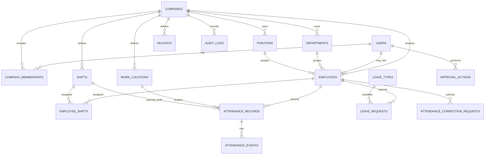

# Database ERD

## Entity relationships

## Relationship notes
- `users` adalah identitas global; `company_memberships` memberi akses user ke tenant tertentu.
- `employees` adalah record ketenagakerjaan dalam satu perusahaan dan dapat terhubung ke user.
- Semua tabel tenant-scoped harus menyertakan `company_id`, langsung atau melalui relasi yang divalidasi.
- `attendance_records` pada MVP memakai satu record per employee per work date. Multi-sesi kerja dalam satu hari adalah keputusan terbuka; jika diperlukan, ubah model sebelum implementasi attendance.
- Selfie metadata disimpan pada attendance record/event; binary foto berada di private object storage.
- Approval action menyimpan siapa yang memutuskan, kapan, keputusan, dan catatan.
